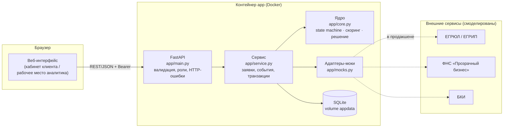
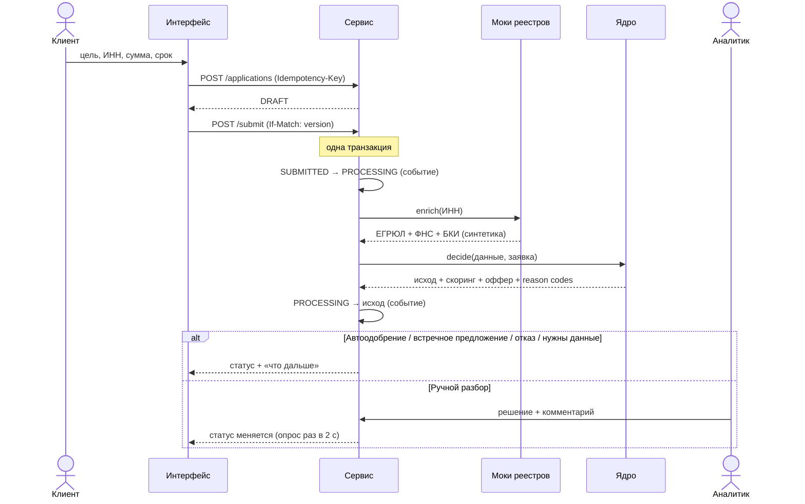

# Архитектура

## Принципы
1. **Одно ядро — два представления.** Заявка и журнал её событий — единственный источник истины. Трекер клиента, рабочее место аналитика и аудит строятся из одних и тех же данных.
2. **Скоринг ≠ кредитное решение.** Скоринг превращает данные в оценку риска; решение учитывает продукт, лимиты, платёжеспособность и политику (см. `ASSUMPTIONS.md`).
3. **Детерминированность и объяснимость.** Решение принимает формализованная модель (правила + балльная карта), а не «чёрный ящик»: каждый балл и каждый reason code виден аналитику.
4. **Адаптеры к внешним системам.** Обогащение данных изолировано в `mocks.py` за единым интерфейсом `enrich(inn)`; замена на реальные клиенты не затрагивает ядро.

## Компоненты

## Сквозной поток заявки

## Надёжность и безопасность

| Мера | Реализация |
|---|---|
| Целостность процесса | Переходы только по таблице `TRANSITIONS`; нарушение → HTTP 409 |
| Атомарность | Смена статуса + запись события + решение — в одной транзакции (`tx()`), откат при ошибке |
| Конкурентность | Оптимистичная блокировка: `version` + заголовок `If-Match` (409 при конфликте) |
| Идемпотентность | `Idempotency-Key` при создании заявки: повтор запроса не создаёт дубль |
| Аудит | Журнал `events` только дополняется; хранит актора, переход, полезную нагрузку |
| Аутентификация | Логин/пароль, пароли — PBKDF2-SHA256 (100 000 итераций, соль), сравнение за постоянное время; Bearer-токены |
| Авторизация | Роли `client` / `analyst`; клиент видит только свои заявки; скоринговые баллы и факторы клиенту не отдаются |
| Контейнер | Запуск не от root, healthcheck, volume для данных, зафиксированные версии зависимостей |
| Защита от XSS | Все динамические значения в интерфейсе экранируются |
| Тестирование | 13 автотестов, CI на GitHub Actions |

## Известные ограничения прототипа (честно)

- **SQLite** — для демо достаточно; для production нужен PostgreSQL (схема переносима).
- **Токены сессий не истекают** и хранятся в БД без TTL; нужен срок жизни и отзыв, а в production — SSO/OIDC банка.
- **Опрос вместо push** (SSE/WebSocket) — проще и надёжнее для демо; нагрузка при масштабировании решается переходом на SSE.
- **Нет rate limiting, CSRF-защиты нужного уровня и шифрования ПДн на уровне полей** — в production обязательны.
- **События не публикуются во внешнюю шину** (нет outbox) — в прототипе все потребители читают одну БД.
- **Нет таймаутов/ретраев/circuit breaker** у адаптеров: моки локальные и мгновенные.

## Путь к production

1. PostgreSQL + миграции (Alembic); разделение чтения очереди и записи.
2. Transactional outbox → брокер сообщений (Kafka/RabbitMQ): асинхронное обогащение и независимое масштабирование модулей.
3. Реальные адаптеры к реестрам и БКИ с таймаутами, ретраями, circuit breaker, кэшем.
4. Корпоративная аутентификация (OIDC), срок жизни и ротация токенов, rate limiting, шифрование ПДн, маскирование в логах.
5. Статистическая скоринговая модель с мониторингом стабильности и различающей способности; сохранение версии модели в решении.
6. Наблюдаемость: структурные логи, метрики конверсии по этапам и времени обработки, трассировка.
7. Горизонтальное масштабирование stateless-API за балансировщиком.
