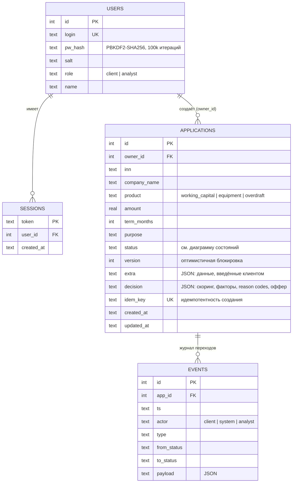

# Модель данных

СУБД: SQLite (файл в docker-томе). Схема — в `app/service.py` (`SCHEMA`). Для промышленной эксплуатации предполагается PostgreSQL: схема переносима без изменения логики.

## Принципы
- **Журнал событий (`events`) только добавляется**, записи не изменяются. На нём строятся трекер клиента и аудит аналитика.
- Все изменения статуса и запись события выполняются в одной транзакции (`tx()`): либо оба, либо ни одного.
- Клиент не получает скоринговые баллы и факторы: они отфильтровываются в `_view()` по роли.
- Данные клиентов и компаний — синтетические (`app/mocks.py`).
