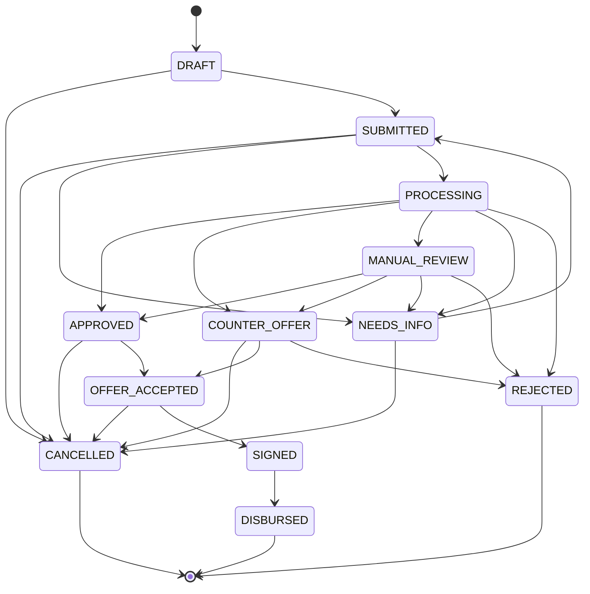

# Диаграмма состояний заявки

Сгенерирована из `TRANSITIONS` в `app/core.py` — единственного источника истины. Любой переход вне этой схемы отклоняется API (HTTP 409).

## Кто и что инициирует переход

| Переход | Инициатор | Условие |
|---|---|---|
| DRAFT → SUBMITTED | клиент | отправка заявки |
| SUBMITTED → PROCESSING | система | автоматически после отправки |
| PROCESSING → APPROVED / COUNTER_OFFER / MANUAL_REVIEW / NEEDS_INFO / REJECTED | система | результат кредитного решения (`decide()`) |
| MANUAL_REVIEW → APPROVED / COUNTER_OFFER / NEEDS_INFO / REJECTED | аналитик | ручное решение, комментарий обязателен |
| NEEDS_INFO → SUBMITTED | клиент | предоставил запрошенные данные; заявка автоматически возвращается в конвейер |
| APPROVED / COUNTER_OFFER → OFFER_ACCEPTED | клиент | принял предложение |
| COUNTER_OFFER → CANCELLED | клиент | отклонил встречное предложение |
| OFFER_ACCEPTED → SIGNED → DISBURSED | клиент / система | подписание и выдача **смоделированы** |
| DRAFT, SUBMITTED, NEEDS_INFO, COUNTER_OFFER, APPROVED, OFFER_ACCEPTED → CANCELLED | клиент | отмена заявки |

Терминальные статусы: DISBURSED, REJECTED, CANCELLED.

Параллельные изменения защищены оптимистичной блокировкой: поле `version` в заявке и заголовок `If-Match` (HTTP 409 при конфликте).
